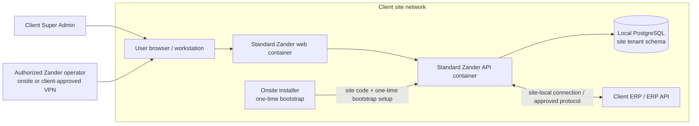
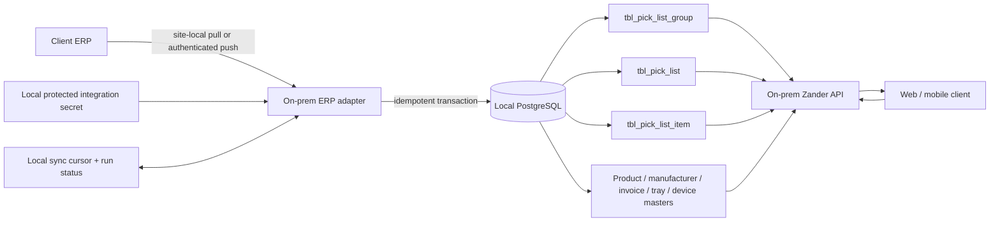

# On-prem WMS: current state and target flow

This note researches the WMS mockup and the `onprem-zander-api` /
`onprem-zander-web` repositories. Zander-Ops is out of scope.

The target for this increment is deliberately simple: one standard release is
installed at each client site; the web app, API, PostgreSQL, users, roles,
configuration, and operational data run there. There is no required control
plane, cloud database, Supabase dependency, remote agent, or central admin
portal. An authorized Zander operator can configure that site's local app when
onsite or through a client-approved VPN/network path. A site-local API is not
reachable from Zander automatically.

## What exists today

### Web/API/data flow

- On-prem web runtime configuration supplies the tenant name (`ZANDER_TENANT`).
  The Angular web app sends login to `GET /{tenantName}/login` with
  `Authorization: Basic <base64(userId:password)>` and `channel: WEB`.
- The API resolves the tenant via the public tenant registry, selects the
  tenant's PostgreSQL schema, authenticates the user, and returns a JWT. Later
  requests use the tenant/schema claim in that JWT.
- User and operational records live in the selected PostgreSQL schema. The
  web app stores the session/token and display data in browser localStorage;
  that browser storage is not the database of record. The API also tracks
  sessions in `tbl_user_session`.
- The database URL is deployment/profile configuration. It may point to a
  local PostgreSQL instance or a cloud-hosted database depending on deployment;
  repository configuration does not prove where a particular production
  customer's database is currently hosted.
- The inspected code has `tenantCode` and `appcode`, not a six-digit
  `siteCode` field. Tenant creation generates `appcode` as four digits. Do not
  use either existing value as the proposed six-digit site code.

### Existing authentication routes and data

`SecurityController` exposes the root-level login/reset routes. User/profile
routes below generally use the `/rest/api/v1` base path. Check Spring security
and individual controller annotations for access requirements; most management
routes require a bearer JWT.

| Route | Current purpose |
|---|---|
| `GET /{tenantName}/login` | Web username/password login. |
| `GET /{tenantName}/loginMobile`, `GET /{tenantName}/login-pin-mobile` | Mobile/app login variants. |
| `GET /login-pin`, `POST /set-mobile-pin`, `GET /check-mobile-pin-status/{emailId}` | PIN login and PIN management. |
| `POST /register`, `POST /{tenantName}/userConfirm` | Registration / account activation flows. |
| `GET /validate_user_actiation_token` | Activation-token validation; `actiation` is the current spelling. |
| `POST /resetPassword?userId=…&tenantName=…` | Public forgot-password request; the user service creates a reset token when the account is found. |
| `GET /validate_reset_password_token?token=…` | Validate a reset token. |
| `POST /savePassword?tenantName=…` | Set a password with a token. |
| `POST /change_password`, `POST /updatePassword` | Legacy channel-specific change and authenticated old/new-password change. |
| `PUT /signout` | End the current session. |
| `GET /rest/api/v1/myProfile`, `POST /rest/api/v1/updateMyProfile` | Get/update the current profile. |
| `POST /rest/api/v1/user`, `POST /rest/api/v1/user_register` | User create/onboarding routes. |
| `GET /rest/api/v1/login/users`, `/users`, `/userss`, `/user-list` | Current-user details and user-list variants. |

The Angular `changepassword()` helper targets
`/rest/api/v1/changepassword`, while the API maps `POST /change_password`.
Treat that legacy path as a route-contract mismatch; the separately implemented
`POST /updatePassword` is the clearer existing change-password route.

Relevant current tables in each tenant schema include:

| Table | What it stores |
|---|---|
| `tbl_user` | User ID, names/contact details, role ID/name, manager ID, status, channel and onboarding flags. |
| `tbl_user_auth` | Credential/auth fields associated with a user. |
| `tbl_role`, `tbl_role_services`, `tbl_screen`, `tbl_user_role_services` | Role, screen/permission, and user-role-service data. |
| `tbl_user_manager` | Manager relationship data; `tbl_user.manager_id` also links a manager. |
| `tbl_user_session` | Login sessions and status/timestamps. |
| `tbl_password_history`, `password_history_model_password_detail` | Password history. |
| `tbl_password_reset_token`, `tbl_verification_token` | Password-reset and account-activation tokens. |
| `tbl_mobile_pin` | Mobile PIN/device data. |
| `public.tbl_tenant` | Tenant registry metadata such as tenant name, schema, `tenantCode`, and `appcode`. It is not the tenant's user store. |

### Authentication issues to address before production

- Passwords are Base64-encoded in the user service, and Spring is configured
  with a no-op password encoder. Base64 is reversible, not password hashing.
  Migrate to Argon2id or BCrypt through Spring's `PasswordEncoder`.
- Password-token expiry uses a `plusDays` calculation with a value named like
  minutes (`60 * 24`); verify and correct the intended expiry before relying on
  it.
- `updatePassword` currently logs the submitted new password. Remove secrets
  from logs.
- The reviewed API has no dedicated `siteCode` login argument or
  `force_password_change` field and no manager-mediated reset-request flow.
- Existing user/role names and authority checks are not yet cleanly separated
  into immutable machine keys and client-editable display aliases.

These are observations from the inspected source, not a claim that every
deployment has the same active profile or configuration.

## What the mockup demonstrates

[`index.html`](./index.html) is a standalone prototype, not a live API client.
It uses seeded accounts and sample outbound records; role switching simulates
views and is not server-side authorization.

- The four top-level departments (Inbound, Inventory, Outbound, Returns) and
  their pages are fixed product structure, not customer-created configuration.
  The mockup allows adding/editing sub-departments under one of those fixed
  departments; it does not provide top-level department or page creation.
- Super Admin controls which fixed pages and sub-pages each role can access.
  These grants are site configuration and must be persisted and enforced by
  the backend as well as reflected in frontend navigation and actions. Hiding
  a page in the UI is not authorization.
- Creating a sub-department requires choosing its parent Department, entering
  the Sub-department name, and optionally entering Manager display name and
  Staff display name. Editing an existing sub-department can change its name
  and both labels. The manager/staff labels are scoped to that department +
  sub-department assignment; blank labels fall back to the standard Manager
  and Staff labels.
- The role hierarchy is Super Admin → Head → Manager → Staff, with scoped
  manager/staff assignments. The mockup also lets Super Admin preview roles
  and configure page access.
- Password reset authorization allows a Manager to reset Staff in their
  department/sub-department, a Head to reset Managers or Staff directly, and
  Super Admin to reset other site users. A Head does not need to wait for a
  Staff member's Manager to perform the reset.
- Terminology settings rename UI labels for roles, departments,
  sub-departments, manager/work labels, and fulfillment terms such as Picklist
  and Group Picklist. These labels should not change permission keys or API
  contracts.
- Super Admin can configure master-page columns per role. This mockup editor
  toggles visibility; it does not offer reordering for those master tables.
- Outbound page column preferences are per role and page/tab and preserve an
  order. The mockup includes invoice/picklist, checker lookup, pick/scan, and
  submission views.
- The current demo stores these settings in the browser:
  `wmsTerminology`, `wmsRolePageAccess`,
  `wmsMasterColumns:v1:<page>:<role>`, and
  `wmsOutboundColumns:v1:<role>:<tab>`. Browser localStorage is per browser
  profile/device and is not shared with another user or browser. It is not
  durable application configuration.
-   The mockup provides both email self-service and role-based reset requests. The
  email option only simulates the intent; no messages or reset links are sent.
  The approver flow simulates a temporary password `user`; it changes no
  database rows. Keep `user` as demo-only: production reset should issue a
  short-lived, single-use random credential or activation link, then require a
  password change.

## Recommended deployment and bootstrap

1. Ship the same versioned web/API images and schema migrations to every site.
   The installer supplies only deployment-specific settings (database
   connection, tenant/site identity, and ERP connectivity). Do not bake client
   credentials or a default Super Admin password into an image or web bundle.
2. Before installation, allocate/record the six-digit site code and Super
   Admin login ID if the workflow needs them to be known in advance. The
   installer initializes the local site record and creates the first
   Super Admin directly in the site's database through a one-time bootstrap
   command or setup endpoint that is disabled after use.
3. Set the initial password through an installation secret prompt/secret
   mount, or generate a one-time random credential and deliver it out of band.
   Store only a strong password hash. Require a password change at first login,
   revoke/expire the bootstrap credential, and record the bootstrap event.
4. The site code is an identifier/routing input, not a password or substitute
   for authentication. Validate its format and resolve it only against the
   local site's configuration. If only one site is served by an installation,
   it can be preconfigured locally; no cloud lookup is needed.
5. After setup, the Super Admin configures roles, departments,
   sub-departments, terms, page access, columns, and ERP connectivity from the
   local app. These settings are stored in the site's PostgreSQL database.
6. If Zander staff need to operate remotely, use the client's approved VPN or
   other explicitly authorized network access to this same local application.
   Without that path, remote access is not available. There is no implicit
   cloud Super Admin in this design.

No Supabase/cloud database is required for this deployment. A cloud service may
later be used for a separately approved purpose (for example release
distribution), but it should not be a dependency for login, site setup, user
management, configuration, or WMS operations.

## Local configuration model

Keep stable machine identities and client-facing aliases separate. The
existing tenant-schema approach can be retained initially: add/migrate these
records into the site's local tenant schema, not a central control-plane DB.
Prefer extending current tables and adding only the configuration tables the
API does not already have.

| Local PostgreSQL table / area | Suggested responsibility |
|---|---|
| `site_configuration` | Six-digit `site_code`, display name, setup state, timezone, active config version. One row per installation/site. |
| Existing `tbl_user`, `tbl_user_auth`, `tbl_user_session` | Users and credentials stay local; add explicit `force_password_change` / reset-state fields through a migration if needed. |
| Existing `tbl_role` plus `role_alias` | Keep immutable `role_key` / existing role ID as authority; store editable per-site role labels separately. Do not authorize on aliases. |
| Fixed department catalog (application-defined) | The four supported `department_key` values and their page/module associations are fixed in the product. They are not inserted as customer-configurable department rows. |
| `tbl_sub_department` (proposed) | Stable `subdepartment_key`, fixed parent `department_key`, display name, optional `manager_display_label` and `staff_display_label`, enabled state, and sort order. Constrain the parent key to Inbound, Inventory, Outbound, or Returns. This stores the selected parent and sub-department-specific role titles. Keep actual role keys `MANAGER` and `STAFF`; labels are presentation only. |
| Existing `tbl_role_services`, `tbl_screen` or a normalized `role_page_permission` | Persist Super Admin-configured grants for each stable role and fixed `page_key`/`subpage_key`. Backend API authorization must check these grants on every corresponding read/write endpoint; the frontend uses them to render navigation and controls but does not enforce security by itself. Keep privileged actions and hierarchy restrictions enforced by API policy too. |
| `site_term` | Stable term key plus configured display label (e.g. `picklist`, `group_picklist`, `staff`). |
| `page_column_preference` | Unique by site/role/page (and tab where applicable); store visible column keys and ordinal position. Allow API to validate against a server-defined column catalogue. |
| Existing `tbl_product`, `tbl_manufacturer`, `tbl_device`, `tbl_tray_master`, `tbl_checker_master` | Existing product/manufacturer/device/tray/checker masters; do not make duplicate mockup-only masters without a data gap. |
| `erp_integration_config` or existing `tbl_integraration` | ERP type, URL/endpoint, enabled state, non-secret options. Store credentials in a protected secret store or encrypted at rest; never return them to the browser or log them. |
| `erp_sync_state` | Per integration/feed cursor or `last_batch`, last success/error, and next retry state. Do not use a cursor without idempotent import behavior. |
| `integration_run` / `configuration_audit` | Import outcomes and who changed/published configuration; redact credentials and sensitive payloads. |

For column preferences, persist keys and order rather than display text. A row
shape can be `(role_key, page_key, tab_key, column_key, visible, position)`,
unique on `(role_key, page_key, tab_key, column_key)`. User aliases and
terminology can change without rewriting operational data, role claims, routes,
or physical database columns.

For page access, use stable application-defined page and subpage keys rather
than customer-created routes. A permission row can be keyed by
`(role_key, page_key, subpage_key, permission_key)` with an enabled flag; a
null/explicit sentinel subpage key can represent a top-level page grant.
Super Admin updates these rows through a configuration API. On each request,
the backend resolves the authenticated user's stable role and assignment scope,
then denies access unless the corresponding grant and operation-level
authorization are satisfied. Frontend navigation and button visibility should
be derived from the same permission response, but backend checks remain
authoritative. Protect permission administration itself so only Super Admin
can change grants.

The sub-department table above is a proposed addition in the site's local
PostgreSQL tenant schema; there is no existing department/sub-department table
identified for this mockup configuration. The four fixed department keys and
their pages stay in the application catalog. The prototype currently saves
sub-department names and manager/staff display labels in `wmsTerminology` in
browser localStorage. Persist the selected fixed parent key and each
sub-department's labels in `tbl_sub_department`; absent labels fall back to
the standard “Manager” and “Staff” terms. Do not create a customer-editable
department table or dynamic department/page registry unless the product scope
changes.

The role hierarchy in the API must verify the actor's role and scope on every
create/reset/configuration request. A Head may administer Managers/Staff in
allowed scope; a Manager may administer Staff assigned to that manager;
Super Admin may administer site users. UI role preview is never a grant.
Department/subdepartment assignment should likewise be validated server-side.

## Outbound ERP → picklist → device flow

### Existing local operational data

The on-prem API already has local tables for the normalized outbound workflow:

| Table | Meaning |
|---|---|
| `tbl_pick_list_group` | Group Picklist header/status, related invoices, checker, scan/start/end and packaging state. |
| `tbl_pick_list` | Picklist records, group number, invoice/location/manufacturer and outbound status/timing fields. |
| `tbl_pick_list_item` | Picklist line items such as product, batch, quantities, prices, scan status and picklist linkage. |
| `tbl_invoice_line_item` | Invoice-level source/detail lines used by group/invoice workflows. |
| `tbl_product`, `tbl_manufacturer` | Product and manufacturer masters. |
| `tbl_tray_master`, `tbl_checker_master`, `tbl_device`, `tbl_device_user_mapping` | Tray, checker, device and device/user assignment data. |

These tables show where API-level outbound data is stored. They do not prove
that a particular ERP feed is active or that all client ERP fields map
identically.

### API read/work routes already present

The picklist and group-picklist controllers are under `/rest/api/v1`:

- Picklists: `GET /picklists`, `GET /fetch-pick-list-all`,
  `GET /fetch-pick-list-detail/{picklistId}`,
  `GET /fetch-pick-list-one/{picklistId}`, and `GET /page/picklist`.
- Group Picklists: `GET /fetch-group-pick-list-all`,
  `GET /fetch-group-pick-list-one/{groupPicklistItemId}`,
  `GET /fetch-group-pick-list-one-view/{groupPicklistItemId}`, and
  `GET /page/group-pick-list`.
- Work operations include picklist/group start-scan, assignment, scan, and
  completion routes. These operate on records already in the local database;
  they are not the ERP import route.
- Tray routes include `GET /all/tray`, `GET /get-all-tray`,
  `GET /active/trays`, and tray create/update/bulk-upload operations.
- Product and manufacturer controllers expose local read/CRUD/upload routes.
  Device routes expose local device and handshake operations.

Confirm exact controller base mappings and payloads against the deployed API
version before implementing a client; route names alone do not guarantee a
stable contract.

### ERP import evidence and gap

`ItrazeIntegrationService` contains a Wondersoft token request
(`POST {url}/Token`, method name `GetToken`) and a picklist-detail request
(`POST {url}/ProcessData`, method name `GetpicklistDetails`, with `Params`).
`tbl_integraration` stores integration URL/user/password/status fields, and a
`tbl_wondersoft_job` model/repository provides `lastBatch` state.

In the reviewed source, I found no active caller wiring that
`GetpicklistDetails` result into `tbl_pick_list`,
`tbl_pick_list_group`, and `tbl_pick_list_item`, and no active scheduler for
that picklist import. `BatchSyncScheduler` is commented out. Therefore the
existing GET endpoints prove that the API can serve local records, not that
picklists are automatically fetched from the ERP. Another client-specific
process may exist outside the reviewed code; verify it and the ERP's exact
payload/specification before replacing it.

### Smallest practical integration

Implement a site-local server-side ERP adapter/job (or accept an authenticated
ERP push) that:

1. Uses the local integration configuration/secret to authenticate to the
   ERP. The browser never receives ERP credentials.
2. Fetches changed outbound source records, including invoices/lines and the
   fields needed to identify the ERP picklist and group. Start with the
   existing Wondersoft helper only if the deployed ERP is Wondersoft and its
   response contract is confirmed.
3. Maps ERP identifiers into stable local source keys, then upserts the
   group header, picklist header(s), line items, and relevant invoice detail
   records transactionally. Preserve ERP IDs/source timestamps for traceability.
4. Uses a unique source identifier and idempotent upsert so retries do not
   duplicate groups/lines. Advance `lastBatch`/cursor only after the
   transaction commits; keep failures visible in a sync-run record and retry
   safely.
5. Lets the existing local list/detail routes serve the imported records to
   web/mobile clients. Start/scan/complete actions update local operational
   state and should not call the ERP unless the integration contract explicitly
   requires a write-back.
6. Builds Group Picklist membership according to the ERP's confirmed grouping
   rule. Do not infer the rule from the current group tables or UI labels.

For a first version, keep the integration inside the on-prem API or a
co-deployed site-local worker. Add the smallest isolated import service and
cursor/audit storage; avoid a cloud sync dependency or a client-specific
frontend fork.

## Password recovery target

Keep both recovery paths: email self-service for users with a verified email,
and manager-mediated reset for users who cannot use email or need administrator
help. The profile page also supports authenticated password changes. The
mockup presents both options, but neither sends real email nor updates the API.
Production should use server-verified authorization:

1. A user requests help; Staff requests normally go to their Manager, Manager
   requests go to Head, and Head requests go to Super Admin. A Head may also
   directly reset a Staff account without waiting for the Manager; Super Admin
   can reset site users. Store a pending request and audit its decision.
2. The authorized approver triggers reset for the target user. Issue a
   per-user, short-lived, single-use random credential or activation link;
   revoke existing sessions and invalidate earlier reset tokens.
3. Require a password change at first login and from the profile page. Hash
   with Argon2id/BCrypt and audit the reset/change without logging secrets.
4. Preserve the existing email/token forgot-password path for users with a
   verified recovery address. Harden it with generic responses, rate limits,
   one-time tokens bound to the local site, and tested expiry. Keep the
   manager-approved path alongside it as an alternate/fallback. Neither path
   should expose whether an account exists in public responses.

This preserves the mockup's chain-of-approval goal without a shared predictable
default password. The demo value `user` is not suitable for production.

## Suggested implementation order

1. Confirm the production site topology, six-digit site-code ownership,
   bootstrap input method, actual ERP product/payload, and existing external
   import process with the onsite team.
2. Add local one-time bootstrap and site configuration migrations; seed
   canonical roles, four departments, current subdepartments, and default
   terminology.
3. Migrate the mockup's browser-only settings into API-backed local PostgreSQL
   settings. Preserve the existing UI shape but fetch/save preferences by
   stable role/page/column keys.
4. Persist Super Admin's role-to-page/subpage grants and enforce them in API
   authorization for every endpoint; use the same grants to render frontend
   navigation. Enforce department scope, reset, and configuration rules in API
   services; never trust browser role switching or alias strings.
5. Harden password hashing, reset expiry, session revocation, and credential
   logging before exposing the new reset flow.
6. Confirm the real ERP import contract, then add a site-local idempotent
   import with visible cursor/run status and tests for retries, updates,
   duplicate deliveries, and partial failures.
7. Keep schema migrations backward-compatible and preserve current picklist,
   group-picklist, scanning, and device workflows while the web app moves from
   mock data to the existing API.

## Mockup picklist-start behavior

The mockup's Picklist and Group Picklist Start buttons simulate the
offline-device confirmation and update sample UI state; they do not call the
live API or hardware. In the on-prem web flow, successful device handshake
starts directly; a non-success response can open manual-processing
confirmation. The existing API start routes are
`PUT /pick-list-start-scan/{picklistId}` and
`PUT /group-pick-list-start-scan/{groupPicklistItemId}`. Keep the existing
outbound role checks and response semantics when wiring persisted data.
