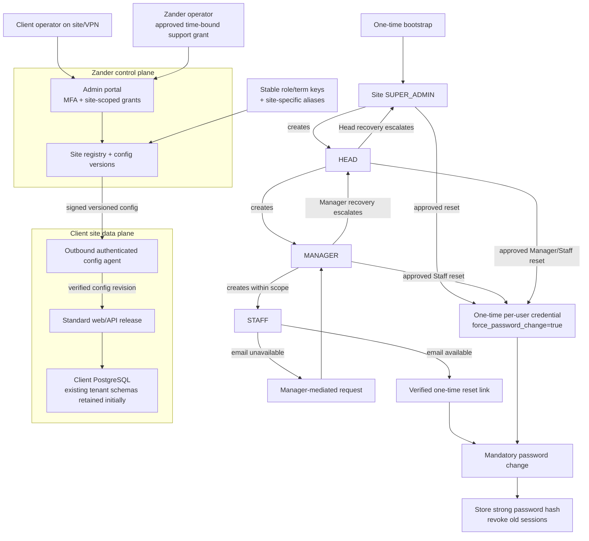

# WMS mockup: authentication research and demo

This is a standalone browser prototype, not an API-connected application. Open
[`index.html`](./index.html). It uses seeded accounts and local JavaScript state;
it does not create database rows, send email, notify a real manager, or call the
on-prem API.

## What the current on-prem API does

Research scope: `onprem-zander-api` and `onprem-zander-web` only. Zander-Ops is
out of scope.

### Login and client-side state

- The Angular web app chooses a tenant from the on-prem runtime configuration
  (`ZANDER_TENANT`); its login request is `GET /{tenantName}/login`.
- Login sends `Authorization: Basic <base64(userId:password)>` and `channel: WEB`.
  The API looks up the tenant in the public tenant registry, changes to its
  PostgreSQL schema, authenticates the user, and returns a JWT and user/role
  information.
- The JWT contains the user as its subject and tenant schema/session claims.
  The API filter reads the tenant claim on later requests and selects that
  schema.
- The web client stores `etraze_token`, `etraze_user`, `etraze_role`,
  `etraze_sessionId`, `etraze_tenantName`, and related values in browser
  `localStorage`. The API separately records sessions in `tbl_user_session`.
- User, role, and credential records are database-side, not browser-side. The
  API uses schema-based PostgreSQL multitenancy: tenant metadata is looked up
  through the `public` schema; application records are read from the selected
  tenant schema. The configured database may be local or AWS RDS, depending on
  the active profile and deployment environment.

### Existing authentication routes

`SecurityController` routes are at the API host root. The user/profile routes
below inherit `/rest/api/v1` through `BaseCrudController` / `BaseRestController`.
Protected routes require a bearer JWT unless noted otherwise.

| Route | Current purpose |
|---|---|
| `POST /register` | Registration request / account onboarding. |
| `GET /{tenantName}/login` | Web username/password login; `Authorization: Basic` plus `channel: WEB`. |
| `GET /{tenantName}/loginMobile` | Mobile login for an app/tenant identifier. |
| `GET /login-pin` | PIN login. |
| `GET /{tenantName}/login-pin-mobile` | Mobile PIN login for an app/tenant identifier. |
| `POST /set-mobile-pin` | Create or update a mobile PIN. |
| `GET /check-mobile-pin-status/{emailId}` | Check mobile PIN status. |
| `GET /check-user-exist/{email}` | Check whether a user exists. |
| `PUT /signout` | Sign out / end the current session. |
| `POST /change_password` | Legacy channel-specific password change. |
| `POST /updatePassword` | Authenticated password change; body has `oldPassword` and `newPassword`. |
| `POST /resetPassword?userId=…&tenantName=…` | Public reset request; creates a reset token when the account is found. |
| `GET /validate_reset_password_token?token=…` | Check a password-reset token. |
| `POST /savePassword?tenantName=…` | Set a password with a reset token; body has `token` and `newPassword`. |
| `POST /{tenantName}/userConfirm` | Complete account activation and set an initial password. |
| `GET /validate_user_actiation_token?token=…&tenantName=…` | Validate activation token (`actiation` is the current route spelling). |
| `GET /resendRegistrationToken?token=…` | Registration-token route; current controller implementation is effectively a stub. |
| `POST /resendActivationMail` | Resend activation message. |
| `GET /rest/api/v1/myProfile` | Get current user's profile. |
| `POST /rest/api/v1/updateMyProfile` | Update profile details. |
| `POST /rest/api/v1/user` | User signup flow. |
| `POST /rest/api/v1/user_register` | User creation flow. |
| `GET /rest/api/v1/login/users` | Get current login user's details. |
| `GET /rest/api/v1/users`, `/rest/api/v1/userss`, `/rest/api/v1/user-list` | User lists / paging, subject to API logic and role checks. |

Reset-token routes are permitted without a JWT in the Spring Security
configuration; most user management and profile routes are authenticated.
`/resetPassword` resolves the tenant and creates a token through the user
service, which has an email-construction path. The current Angular forgot
password flow calls this endpoint. This API has no six-digit site-code argument
or site-code lookup in the reviewed login path.

The Angular `changepassword()` helper currently targets
`/rest/api/v1/changepassword`, while the API controller mapping is
`POST /change_password`. Treat that as a route-contract mismatch to verify
before relying on the legacy endpoint. The newer `POST /updatePassword` route
is separately implemented.

The reviewed API exposes no manager-mediated reset-request or
reset-to-temporary-password endpoint. It has user/manager relationships and a
token-based self-service reset, but the role escalation workflow described
below is a target design, not existing API behavior.

### Existing auth-related data model

The migration `onprem-zander-api/src/main/resources/db/migration/tenancy/V1__tenancy_table.sql`
and JPA models describe these relevant tables. Common `BaseModel` columns
include `created_on`, `modified_on`, `created_by`, `modified_by`, `version_no`,
and `tenant_id`.

| Table | Current purpose / important fields |
|---|---|
| `tbl_user` | Identity and assignment: `user_id` (key), first/last name, email, phone, `role_id`, `role_name`, `manager_id`, status, channels, enabled/onboarding flags, and tenant metadata. |
| `tbl_user_auth` | Credential record keyed by `id`, with `user_id`, `email_id`, `password`, mobile `passcode`, enabled/expiry/credential-expired flags, and password expiry date. |
| `tbl_role` | Role ID, role name, description. `role_name` is also used as the Spring Security authority, so it is not merely a presentation label today. |
| `tbl_role_services` | Role-to-screen grants (`role_id`, `screen_id`). |
| `tbl_screen` | Screen metadata and create/read/update/delete/view permission flags. |
| `tbl_user_role_services` | Per-user role/screen assignments and labels. |
| `tbl_user_manager` | User-to-manager relationship data. `tbl_user.manager_id` also represents manager linkage. |
| `tbl_user_session` | Session ID, user ID, status, timestamps, IP/location, and user-agent information. |
| `tbl_password_history` and `password_history_model_password_detail` | Recent password history; the service keeps up to three entries. |
| `tbl_password_reset_token` | Reset token, expiry, and associated `UserAuth`. |
| `tbl_verification_token` | Activation token, expiry, status, and associated `UserAuth`. |
| `tbl_mobile_pin` | Mobile PIN/device data associated with a user/auth record. |
| `public.tbl_tenant` model | Tenant identity, name/status, schema name, `tenantCode`, and `appcode`; it is separate from the tenant-scoped user tables. |

The current API has `tenantCode` and `appcode`, not a `siteCode` column. Tenant
creation sets `tenantCode` from the tenant-name prefix and generates `appcode`
as a four-digit number. Do not treat either as the proposed six-digit site code.

### Important implementation caveats

- `UserService` Base64-encodes passwords, which is reversible encoding, not
  password hashing. `SecurityConfigurer` also configures a no-op password
  encoder. Use Argon2id or BCrypt through Spring's `PasswordEncoder` before a
  production rollout; do not copy this storage behavior into the new design.
- Password reset/verification token expiry code uses `plusDays` with a value
  named as minutes (`60 * 24`), so review and correct expiry semantics before
  relying on those links.
- The API does not currently bind login to a six-digit site code or expose a
  dedicated `force_password_change` field. Existing first-login flags such as
  `new_user_validate_web` are not the same as a well-defined temporary-password
  lifecycle.
- `SecurityController.updatePassword` logs the submitted new password at error
  level. Remove credential values from logs before production use.
- Never make the shared word `user` a production temporary password. The
  mockup uses it only because that is the requested demonstration; production
  should issue a per-user one-time random credential or activation link, store
  only a modern password hash, and require a change on first use.

## Mockup flow implemented here

The mockup now demonstrates:

1. A bootstrapped Super Admin can preview seeded Head, Manager, and Staff roles
   using **Profile → Demo role preview**.
2. A user enters the demo site code, user ID, and password. Demo site code is
   `123456`; seeded accounts initially use `ZanderDemo123!`.
3. **Forgot password?** records a local pending request and tells the user who
   to contact: Staff → their Manager; Manager → Head; Head → Super Admin.
4. The authorized manager can see the request on **Administration → Users**,
   or open a permitted user's record, then reset it to the demo default
   password `user`. A Manager can reset Staff in their own sub-department; a
   Head can reset Managers/Staff; a Super Admin can reset any role.
5. The user signs in with `user`, opens the profile icon, and changes their
   password using current/new/confirm fields. The demo requires at least eight
   characters for the new password and removes the forced-change notice after
   success.

The profile displays basic user, role, site, department, and manager details.
The profile icon opens this page for every role. Role preview is a mockup-only
Super Admin control; it does not replace server-side authorization.

Passwords and reset requests in this implementation are held in JavaScript
memory only and disappear on reload. The six-digit code is a fixed demo value,
not a client site credential. No actual notification is sent; the request is
shown only to authorized approvers in the same browser session.

## Recommended target design

Keep authorization identifiers stable and customize labels separately:

- `role_key` values such as `SUPER_ADMIN`, `HEAD`, `MANAGER`, `STAFF` are
  immutable system keys.
- `site_role_alias` maps a site's role key to its customer-facing label
  (`HEAD` → “Warehouse Lead”, for example). Changing the label must not change
  the security authority.
- A `site_term` table (or equivalent settings JSON) maps configurable UI terms
  such as department, warehouse, and staff labels. Keep API field names and
  database keys stable; only presentation terminology varies by client.
- Treat the six-digit `site_code` as a site lookup identifier, not a secret or
  a substitute for the user's password. Enforce uniqueness and format at the
  database and API layers.
- Store explicit reporting relationships (`manager_user_id`) and check reset
  scope server-side, in the same site, rather than trusting a role selector or
  client-side route guard.

### One standard product, configurable per site

The goal is not one giant deployment that must be online to every client. It is
one versioned product and one configuration model, with the option to run the
client data plane locally:

- **Control plane (Zander-operated):** central site registry, site-code
  assignments, configuration versions, license/release metadata, and the
  centrally authenticated support/admin portal. Keep this database limited to
  control-plane data unless a customer explicitly chooses cloud-hosted WMS data.
- **Site data plane (client-operated):** the standard web/API release and that
  client's PostgreSQL data. Keep client operational records and credentials in
  the client's environment for on-prem deployments.
- **Configuration channel:** the on-prem site initiates an outbound,
  mutually-authenticated connection to fetch a signed, versioned configuration
  bundle. Do not expose the client's database or an unauthenticated admin API
  to the internet. A site with no outbound access can import the same signed
  bundle through an approved offline deployment process.
- **Admin portal:** a Zander platform operator may select a site only after
  strong authentication (MFA), an explicit support grant, and audited
  site-scoped authorization. The client's Site Super Admin manages only their
  own site. These are separate authorities even if the UI uses similar labels.

This allows an operator at Zander or an authorized operator at the client to
use the same standard portal and manage the same site configuration. At the
client, the portal can talk directly to the local API. From Zander, access must
go through the approved outbound relay/agent or the client's VPN; a local-only
API is not magically reachable from the cloud. The agent should accept only
signed, versioned, allow-listed configuration changes and report its applied
version. Remote support access should be time-bounded, revocable, and audited;
avoid a shared global account or silent impersonation.

For the first increment, preserve today's PostgreSQL tenant schemas and data
layout. Add control-plane configuration records keyed by stable `site_id`, and
adapt the API/web to load those records as runtime configuration. This avoids
moving business tables while separating customization from client-specific
code. Continue using the same API artifact/image at each site; the site-specific
database URL, secrets, and connection pool remain deployment secrets, not
control-plane values sent to the browser. The current web runtime config already
demonstrates one web image selected by tenant runtime config, but the reviewed
API still has environment-specific DB profiles and there is no remote
configuration agent/control-plane channel yet.

Initially map each existing `public.tbl_tenant.tenantId` to the new stable
control-plane `site_id`; keep existing `schemaName` and login resolution working
through a compatibility adapter. The control plane should not duplicate
passwords or business data from the tenant database.

Store configuration as normalized, versioned records rather than client forks:

| Concern | Stable key / record | Site-specific value |
|---|---|---|
| Site | `site_id`; unique six-digit `site_code` lookup | display name, enabled state, supported release |
| Roles | immutable `role_key` such as `HEAD` or `STAFF` | alias such as “Warehouse Lead” |
| Departments | immutable `department_key` | display name, enabled state, order |
| Sub-departments | immutable key scoped to department | display name, enabled state, order |
| Terms | semantic `term_key` such as `STAFF_LABEL` | translated/customer-facing label |
| Permissions | stable role/action/resource keys | permitted grants within a bounded policy |
| Site features | stable feature keys | enabled values and validated settings |

Web components should render labels from a versioned configuration response.
API routes, database column names, authorization checks, and integration
contracts must use stable keys, never aliases. A label change should not require
a schema migration or alter a user's authority. Use configuration validation,
preview, publish/rollback, and an audit record for each change. Cache the
active version at each site so normal work continues during a control-plane
outage; show whether a site is current or has unapplied changes.

Do not make the Super Admin UI a general-purpose SQL editor or allow arbitrary
runtime role creation to grant privilege. Offer a curated role catalog and
permission templates; allow bounded overrides, with high-risk grants requiring
explicit approval and audit. Keep “platform operator”, “site super admin”,
“Head”, “Manager”, and “Staff” as distinct stable authority keys. Customer
aliases affect only display text.

### Minimal migration plan

1. **Stabilize identity first:** map current `tbl_role.role_id` values to
   canonical immutable role keys while preserving the old IDs for backward
   compatibility. Introduce a separate display-alias lookup; stop treating
   editable `role_name` as the authorization source. Add the six-digit
   `site_code` as a unique site registry field; do not overload `tenantCode` or
   the existing four-digit `appcode`.
2. **Make configuration data-driven:** add site-scoped department,
   sub-department, term/alias, feature, and role-permission configuration with
   a version number. First migrate today's labels and grants into defaults so
   existing clients see no behavior change. Add API read/update/publish
   endpoints with validation and audit.
3. **Separate modules in the code, not deployments:** introduce bounded API
   services/modules for identity, authorization, site configuration, user
   lifecycle, and audit. Keep the existing endpoints as compatibility adapters
   to those services; migrate the web client incrementally. Avoid per-customer
   branches and new schema copies just to rename “Head” or “Department”.
4. **Support remote administration:** first let the site API load local
   configuration. Then add the central registry and outbound site agent for
   remote changes, with signed revisions, acknowledgement, rollback, and
   offline behavior. A central portal without that connection (or VPN) can
   administer only cloud-hosted site data, not a customer's isolated database.
5. **Harden auth before rollout:** replace reversible Base64/no-op credential
   handling with Argon2id or BCrypt and a migration-on-success strategy;
   revoke existing sessions on administrative reset; remove secrets from logs;
   test the hierarchy and every tenant/site boundary server-side.

This is a gradual transition. Do not consolidate all current tenant schemas
into one shared schema as a prerequisite. A future row-level multi-tenant model
could reduce schema management, but it is a separate migration with much
greater isolation and regression risk. The first modularity win is standard
code plus configuration and stable identities, not an immediate database
rewrite.

One possible PostgreSQL core schema (illustrative, not yet applied):

```sql
CREATE TABLE site (
    site_id UUID PRIMARY KEY DEFAULT gen_random_uuid(),
    site_code CHAR(6) NOT NULL UNIQUE CHECK (site_code ~ '^[0-9]{6}$'),
    display_name TEXT NOT NULL,
    status TEXT NOT NULL DEFAULT 'ACTIVE'
);

CREATE TABLE role_catalog (
    role_key TEXT PRIMARY KEY
);

CREATE TABLE site_role_alias (
    site_id UUID NOT NULL REFERENCES site(site_id),
    role_key TEXT NOT NULL REFERENCES role_catalog(role_key),
    display_label TEXT NOT NULL,
    PRIMARY KEY (site_id, role_key)
);

CREATE TABLE site_term (
    site_id UUID NOT NULL REFERENCES site(site_id),
    term_key TEXT NOT NULL,
    display_label TEXT NOT NULL,
    PRIMARY KEY (site_id, term_key)
);

CREATE TABLE app_user (
    user_id UUID PRIMARY KEY DEFAULT gen_random_uuid(),
    site_id UUID NOT NULL REFERENCES site(site_id),
    login_id TEXT NOT NULL,
    full_name TEXT NOT NULL,
    email TEXT,
    role_key TEXT NOT NULL REFERENCES role_catalog(role_key),
    manager_user_id UUID,
    created_by UUID,
    department_key TEXT,
    subdepartment_key TEXT,
    status TEXT NOT NULL DEFAULT 'ACTIVE',
    created_at TIMESTAMPTZ NOT NULL DEFAULT now(),
    UNIQUE (site_id, login_id),
    UNIQUE (site_id, user_id),
    FOREIGN KEY (site_id, manager_user_id)
        REFERENCES app_user(site_id, user_id),
    FOREIGN KEY (site_id, created_by)
        REFERENCES app_user(site_id, user_id)
);

CREATE TABLE user_credential (
    user_id UUID PRIMARY KEY REFERENCES app_user(user_id),
    password_hash TEXT NOT NULL,
    force_password_change BOOLEAN NOT NULL DEFAULT FALSE,
    password_changed_at TIMESTAMPTZ,
    failed_attempts INTEGER NOT NULL DEFAULT 0,
    locked_until TIMESTAMPTZ
);

CREATE TABLE password_reset_request (
    request_id UUID PRIMARY KEY DEFAULT gen_random_uuid(),
    site_id UUID NOT NULL REFERENCES site(site_id),
    target_user_id UUID NOT NULL REFERENCES app_user(user_id),
    status TEXT NOT NULL DEFAULT 'PENDING'
        CHECK (status IN ('PENDING', 'APPROVED', 'COMPLETED', 'REJECTED')),
    requested_at TIMESTAMPTZ NOT NULL DEFAULT now(),
    resolved_by UUID,
    resolved_at TIMESTAMPTZ,
    FOREIGN KEY (site_id, target_user_id)
        REFERENCES app_user(site_id, user_id),
    FOREIGN KEY (site_id, resolved_by)
        REFERENCES app_user(site_id, user_id)
);

CREATE TABLE user_session (
    session_id UUID PRIMARY KEY DEFAULT gen_random_uuid(),
    user_id UUID NOT NULL REFERENCES app_user(user_id),
    created_at TIMESTAMPTZ NOT NULL DEFAULT now(),
    expires_at TIMESTAMPTZ NOT NULL,
    revoked_at TIMESTAMPTZ
);

CREATE TABLE password_history (
    user_id UUID NOT NULL REFERENCES app_user(user_id),
    changed_at TIMESTAMPTZ NOT NULL DEFAULT now(),
    password_hash TEXT NOT NULL,
    PRIMARY KEY (user_id, changed_at)
);

CREATE TABLE security_audit (
    event_id UUID PRIMARY KEY DEFAULT gen_random_uuid(),
    site_id UUID NOT NULL REFERENCES site(site_id),
    actor_user_id UUID,
    subject_user_id UUID,
    event_type TEXT NOT NULL,
    details JSONB NOT NULL DEFAULT '{}'::jsonb,
    created_at TIMESTAMPTZ NOT NULL DEFAULT now(),
    FOREIGN KEY (site_id, actor_user_id)
        REFERENCES app_user(site_id, user_id),
    FOREIGN KEY (site_id, subject_user_id)
        REFERENCES app_user(site_id, user_id)
);

CREATE TABLE site_department (
    site_id UUID NOT NULL REFERENCES site(site_id),
    department_key TEXT NOT NULL,
    display_label TEXT NOT NULL,
    enabled BOOLEAN NOT NULL DEFAULT TRUE,
    sort_order INTEGER NOT NULL DEFAULT 0,
    PRIMARY KEY (site_id, department_key)
);

CREATE TABLE site_subdepartment (
    site_id UUID NOT NULL,
    department_key TEXT NOT NULL,
    subdepartment_key TEXT NOT NULL,
    display_label TEXT NOT NULL,
    enabled BOOLEAN NOT NULL DEFAULT TRUE,
    sort_order INTEGER NOT NULL DEFAULT 0,
    PRIMARY KEY (site_id, department_key, subdepartment_key),
    FOREIGN KEY (site_id, department_key)
        REFERENCES site_department(site_id, department_key)
);

CREATE TABLE site_role_permission (
    site_id UUID NOT NULL REFERENCES site(site_id),
    role_key TEXT NOT NULL REFERENCES role_catalog(role_key),
    permission_key TEXT NOT NULL,
    enabled BOOLEAN NOT NULL DEFAULT FALSE,
    PRIMARY KEY (site_id, role_key, permission_key)
);

CREATE TABLE site_config_revision (
    site_id UUID NOT NULL REFERENCES site(site_id),
    revision_no INTEGER NOT NULL,
    status TEXT NOT NULL CHECK (status IN ('DRAFT', 'PUBLISHED', 'RETIRED')),
    config_snapshot JSONB NOT NULL,
    created_by UUID,
    created_at TIMESTAMPTZ NOT NULL DEFAULT now(),
    published_at TIMESTAMPTZ,
    PRIMARY KEY (site_id, revision_no),
    FOREIGN KEY (site_id, created_by)
        REFERENCES app_user(site_id, user_id)
);
```

In the full application, add a scoped warehouse/department assignment table and
an append-only security audit table. Add indexes on `(site_id, login_id)`,
`(site_id, manager_user_id)`, and pending reset requests. Enforce all role
hierarchy rules in the API inside a transaction, and revoke existing sessions
after a reset. The revision snapshot is published atomically; the site agent
only applies a verified `PUBLISHED` revision and reports the applied revision
to the control plane.

### Recommended lifecycle and endpoint contract

1. A one-time deployment/bootstrap command creates the first
   `SUPER_ADMIN` (without a committed default password).
2. Super Admin creates a Head. Head creates Managers and Staff. Manager creates
   Staff only within assigned scope. The role code stays unchanged when the
   displayed alias is edited.
3. Login: `POST /auth/login` with `{ "siteCode", "userId", "password" }`.
   Resolve `siteCode` to `site_id`, validate credentials, then return a JWT
   containing stable `user_id`, `site_id`, and `role_key` claims.
4. Self-service forgot password: retain the existing token/email approach for
   users who can access their verified recovery channel. Reuse its token
   lifecycle only after correcting and testing expiry, one-time use, tenant
   binding, rate limits, and generic responses that do not disclose whether an
   account exists.
5. Manager-mediated recovery: add
   `POST /auth/password-reset-requests` with site code and user ID for users who
   cannot use email. Return a generic response and create a pending request
   visible to the authorized approver. Staff requests go to their assigned
   Manager; Manager to Head; Head to the site Super Admin. The platform
   operator is a separately granted escalation path, not an implicit
   site-wide account.
6. Approver: `POST /users/{userId}/password-reset`. The server verifies
   same-site scope and the role hierarchy, issues a **per-user one-time random
   reset secret or activation link** through a verified channel, sets
   `force_password_change = true`, revokes sessions, expires prior reset
   tokens, and writes an audit event. Never expose a shared literal password
   such as `user` to all accounts or show the generated secret to the approver.
7. First login after reset must require a password change through
   `POST /auth/password-change`. Validate the new/confirm values, hash the new
   password, clear `force_password_change`, and record a password-change audit
   event. If the user lacks any verified recovery channel, use the
   manager-mediated approval and a one-time credential that the user changes
   immediately.

**Recommendation:** use a hybrid, not either flow alone. Keep self-service
email reset as the quickest path for ordinary users; provide the manager
approval/reset path as a controlled fallback for warehouse users without
reliable email. A manager-mediated request is safer than an unauthenticated
public "set password to `user`" action, but it should issue a short-lived,
single-use credential rather than a predictable shared default. The profile
change form is useful, but a mandatory first-login change page is needed too,
because a user may sign in on a scanner or another route without visiting the
profile first.



## Existing picklist-start behavior

The Start actions on Picklist and Group Picklist use the themed offline-device
confirmation and preserve the existing outbound role/permission checks.
Choosing **No** leaves the record unchanged. Choosing **YES** simulates the
on-prem start response (`code: "0000"`, `message: "Scan Started"`), updates the
mock record, and opens the corresponding checking view; barcode submission
remains available from that view. In on-prem, the success routes are
`/en/home/invoice-checking/{picklistNumber}` for a picklist and
`/en/home/invoice-details/{groupPicklistNumber}` for a group picklist.

This is a standalone prototype and does not call the live API or device.
On-prem proceeds directly when `device-handshake` returns `"0000"`; any other
response opens the manual-processing confirmation. After confirmation, it
starts a picklist with `pick-list-start-scan/{picklistId}` or a group picklist
with `group-pick-list-start-scan/{groupPicklistItemId}`. Those endpoints return
the common `{ code, message, data }` result; the services report `"0000"` with
`"Scan Started"` on success and `"1111"` with `"Error While Started Scan"` when
start fails. The web client also handles `"2222"` as an already-started response.
